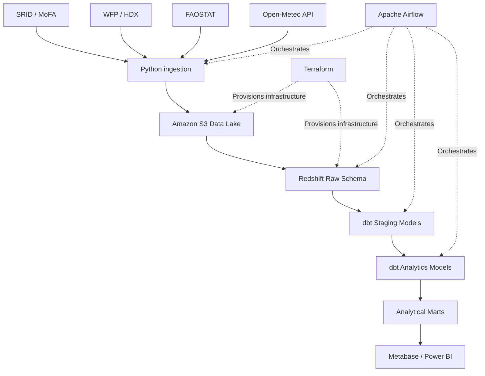

# AgroLens — Data Platform Architecture

## 1. Project overview

AgroLens is a Ghanaian agricultural market intelligence platform integrating commodity prices, agricultural production and rainfall data.

Its purpose is to investigate:
- Commodity price differences across Ghanaian markets.
- Historical price movements and seasonal anomalies.
- Relationships between rainfall patterns and subsequent price movements.
- Agricultural production trends and potential food-security risks.

The platform combines historical data with a more recent market-price snapshot. It is not a real-time market intelligence system.

## 2. Technology stack

| Component | Technology |
|---|---|
| Cloud infrastructure | AWS |
| Infrastructure as Code | Terraform |
| Data lake | Amazon S3 |
| Data ingestion | Python and Airbyte where appropriate |
| Orchestration | Apache Airflow |
| Data warehouse | Amazon Redshift Serverless |
| Transformation | dbt |
| Visualisation | Metabase / Power BI |
| Monitoring | Amazon CloudWatch |
| Version control | Git and GitHub |
| CI/CD | GitHub Actions |

## 3. Data sources

| Source | Dataset | Purpose |
|---|---|---|
| SRID / MoFA | Weekly market prices, 2025 | Recent market-price snapshot |
| WFP / HDX | Historical food prices, 2006–2023 | Historical price analysis |
| FAOSTAT | Annual agricultural production | Production context |
| Open-Meteo | Historical daily weather | Rainfall analysis |

### Commodity scope

The overall commodity scope is:
- Rice
- Maize
- Cocoa beans
- Groundnuts
- Cassava
- Yam

A commodity will only be included in an analysis when the required source contains usable observations. Groundnuts, for example, are available in FAOSTAT but absent from the profiled WFP price dataset.

## 4. High-level data flow



Airflow coordinates the end-to-end workflow, including ingestion, loading, transformation and validation.

## 5. S3 data lake organisation

Use source-, dataset- and ingestion-date-based prefixes.

```text
agrolens-data-lake/
├── source=srid/
│   └── dataset=market_prices/
│       └── ingested_at=YYYY-MM-DD/
├── source=wfp/
│   └── dataset=historical_prices/
│       └── ingested_at=YYYY-MM-DD/
├── source=faostat/
│   └── dataset=production/
│       └── ingested_at=YYYY-MM-DD/
└── source=open_meteo/
    └── dataset=rainfall/
        └── ingested_at=YYYY-MM-DD/
```

These are logical S3 prefixes, not physical folders.

Raw source files should be retained unchanged. New ingestion runs should not silently overwrite previous raw snapshots.

## 6. Warehouse organisation

Redshift will use three schemas.

| Schema | Responsibility |
|---|---|
| `raw` | Source data loaded from S3 |
| `staging` | Cleaned and standardised dbt models |
| `analytics` | Business-ready analytical models |

### Proposed fact tables

| Fact table | Grain |
|---|---|
| `fct_prices_historical` | One WFP price observation per market, commodity, date, price type and unit |
| `fct_prices_current` | One SRID price observation per market, commodity, date and price type, retaining source-specific attributes |
| `fct_production_annual` | One commodity, year and production measure |
| `fct_rainfall_daily` | One daily rainfall observation per selected location |

### Proposed dimensions

- `dim_date`
- `dim_market`
- `dim_commodity`
- `dim_unit`
- `dim_region`
- `dim_location`

The dimensions provide consistent descriptive attributes and identifiers for analytical queries.

## 7. Data standardisation rules

### Price data
- Keep WFP and SRID in separate fact tables.
- Standardise eligible weight-based prices to GHS/kg.
- Preserve original prices and units.
- Do not convert bunches, tubers or pieces without defensible conversion factors.
- Verify the SRID price-unit definition before applying conversions because its profiled fields do not include an explicit unit column.

### Market names
- Maintain `market_mapping.csv`.
- Map verified source names to canonical market names.
- Flag invalid market entries for exclusion.
- Fill the 434 missing SRID market names with Techiman, retaining a `market_was_imputed` indicator.

### Commodity names
- Maintain `commodity_mapping.csv`.
- Standardise source-specific names.
- Preserve meaningful varieties, particularly local and imported rice.

### Production data
- Preserve all FAOSTAT observations and their flags.
- Retain the original flag and description.
- Use official observations (`A`) by default for indicators requiring official production figures.

### Rainfall linkage
- Link rainfall to market prices at the regional level.
- Use representative coordinates for selected regions.
- Document that regional rainfall may not represent rainfall in specific farming communities.
- Interpret rainfall-price relationships as associations, not proof of causation.

## 8. Analytical marts

| Mart | Business purpose |
|---|---|
| `mart_price_board` | Compare commodity prices across markets |
| `mart_price_anomaly` | Identify unusual prices against seasonal baselines |
| `mart_market_lead_lag` | Investigate market price movements and potential leading markets |
| `mart_rainfall_price_lag` | Analyse rainfall and subsequent price movements |
| `mart_risk_indicator` | Combine rainfall, production and price signals to investigate potential food-security risks |

## 9. Reliability and data quality

The pipeline should implement:

- Schema and data-type validation.
- Required-field and null checks.
- Duplicate detection using source-appropriate business keys.
- Numeric and date-range validation.
- Commodity and market mapping validation.
- Unit-conversion validation.
- Row-count and ingestion audit logging.

### Failure handling

- Log failed pipeline tasks with useful error information.
- Retry transient failures where appropriate.
- Avoid retrying permanent data-quality failures without correction.
- Keep invalid records available for investigation rather than silently discarding them.
- Fail the relevant pipeline stage when critical validation checks fail.

### Idempotency

Repeated ingestion or loading should not create unintended duplicate records.

Use source identifiers and appropriate business keys to identify observations. Preserve raw ingestion snapshots while making downstream loading and transformations safe to rerun.

## 10. Known data limitations

1. SRID provides only April–October 2025 data in the profiled dataset.
2. WFP historical data ends in July 2023, leaving a gap before the SRID snapshot.
3. SRID has no Northern Region observations.
4. Market names do not consistently match between WFP and SRID.
5. SRID has no usable market coordinates in the profiled data.
6. Some WFP commodities use non-weight units that cannot safely be converted to GHS/kg.
7. Groundnuts are present in FAOSTAT but absent from WFP prices.
8. Regional rainfall is an approximation and does not necessarily represent actual production-area rainfall.

These limitations must be reflected in analytical interpretations and project documentation.

## 11. Architecture implementation sequence

1. Complete and document architecture decisions.
2. Implement source-specific ingestion.
3. Store raw source data in S3.
4. Load source data into Redshift raw schemas.
5. Build dbt staging models.
6. Build analytical marts.
7. Orchestrate the end-to-end workflow with Airflow.
8. Implement data-quality checks and monitoring.
9. Build dashboards.
10. Complete integration testing and release documentation.

